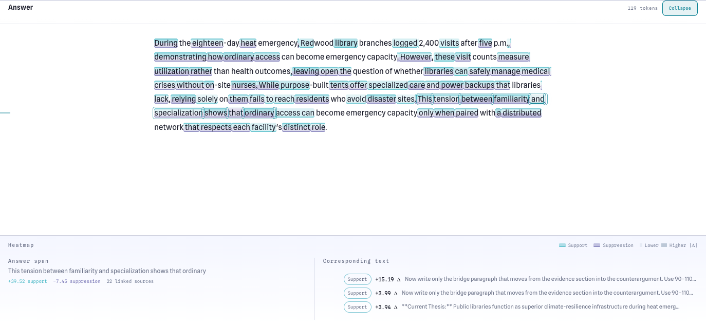

# Clozn

> Context attribution for everyday local inference. **Work in progress.**

Wondering how your context is influencing a model? Which parts of an answer actually depend on your
conversation, documents, or instructions—and which survive without them? Is the model ignoring
something you said? Want evidence without building a notebook or instrumenting your chat app?

**Clozn can help.**

Clozn is a local, text-only OpenAI-compatible chat gateway with context attribution built in. Point an
existing chat client at Clozn, chat with a local GGUF model as usual, then open the recorded response in
Studio. Clozn automatically partitions the complete message history and runs removal experiments to
show which context spans support or suppress each part of the answer.

Clozn builds on the context-attribution research direction established by
[ContextCite](https://github.com/MadryLab/context-cite), bringing research-inspired measurements into
an everyday chat loop. The v1 POC uses its own direct, teacher-forced removal scoring rather than being
a port of ContextCite's estimator.



*Answer heatmap: color and intensity encode support or suppression; selecting a span reveals its
strongest corresponding context.*

Analysis requires additional model passes and can take minutes on local hardware. Chat generation
itself remains a normal OpenAI-compatible request.

## What the v1 POC includes

The proof of concept is deliberately narrow:

- a text-only OpenAI Chat Completions API for one local GGUF model;
- automatic Markdown-aware chunking across every input message;
- Context Effects linking context spans to answer spans;
- linked, heatmap, influence-ranking, and bounded Lean Context views;
- Minimal Context with exact answer and termination verification; and
- durable local runs, original-versus-reduced comparison, and basic deletion.

Research workbenches, J-lens/SAE views, steering, snapshots, model comparison suites, tools/structured
output, Responses, and Ollama-compatible APIs are not part of v1. See the
[implementation plan](docs/V1_POC_PLAN.md) and [current capability boundary](docs/CAPABILITIES.md).

## Quickstart from a source checkout

Build the private worker first; this source snapshot does not include a published native binary:

```sh
python engine/core/third_party/bootstrap_llama.py
cmake -S engine/core -B engine/core/build -G Ninja \
  -DCMAKE_BUILD_TYPE=Release \
  -DCLOZN_BUILD_GGML=ON \
  -DCLOZN_BUILD_SERVE=ON \
  -DGGML_METAL=ON
cmake --build engine/core/build --target clozn-server
```

Use `-DGGML_CUDA=ON` on a CUDA host, or disable both Metal and CUDA for CPU. Then start one model:

```sh
python -m clozn serve /absolute/path/to/model.gguf --port 8080
python -m clozn studio --port 8080 --open
```

The same runtime can serve a command-line request:

```sh
python -m clozn run /absolute/path/to/model.gguf "Explain entropy."
```

The public CLI is exactly:

```text
run  serve  models  pull  studio  ps  stop  version  doctor
```

`clozn serve` also accepts the documented single-model aliases `-m`, `-c`, `-ngl`, `--host`, `-a`,
and `-np 1`; see [llama-server-style flags](docs/LLAMA_SERVER_COMPATIBILITY.md).

## Text API

Point an OpenAI-compatible client at `http://127.0.0.1:8080/v1`, or call the endpoint directly:

```sh
curl http://127.0.0.1:8080/v1/chat/completions \
  -H 'Content-Type: application/json' \
  -d '{
    "model": "clozn-local",
    "messages": [{"role": "user", "content": "Explain entropy."}],
    "stream": false
  }'
```

The supported public model endpoints are `GET /v1/models` and `POST /v1/chat/completions`.
Unsupported behavior-bearing fields receive a typed HTTP 400 instead of being ignored. Exact request
fields and response extensions are documented in [OpenAI compatibility](docs/OPENAI_COMPATIBILITY.md).

Completed generation must be durably recorded before Clozn returns success. Non-streaming responses
include `clozn_run_id` and `X-Clozn-Run-Id`; the terminal streaming chunk includes `clozn_run_id`.

## Studio journey

Studio has a run list/composer and one run workspace:

1. create a run from one Markdown/plain-text prompt and optional instructions;
2. inspect input and output in Context Effects;
3. measure how removing a recorded source changes the likelihood of selected answer text;
4. run Minimal Context and cancel it if needed;
5. save the best exact-preserving result; and
6. compare the reduced child with its original or reopen both after restart.

Every non-empty input message is eligible for automatic chunking, including system instructions and the
latest user message. Context Effects and Minimal Context use the same canonical source identities.
Context Effects is a teacher-forced intervention measurement; Minimal Context separately verifies the
recorded answer and stop behavior. Low measured effect, unmeasured, unavailable, failed, and
exact-preserved are distinct states. Clozn derives a flat Markdown-aware context partition automatically;
`CLOZN_MAX_CONTEXT_ARMS` sets its maximum number of analysis arms (default 16).

## Data and privacy

v1 stores its SQLite journal, immutable trace blobs, evidence, and results under
`~/.clozn/v1/` by default. Set `CLOZN_DATA_ROOT` to choose an isolated location. Historical data under
`~/.clozn/runs/` is not imported or modified.

Run deletion is transactional and refuses to remove a parent while saved children still depend on it.
Unreferenced content-addressed blobs are cleaned through the run mutation path.

## Qualification

With a gateway already running, exercise the retained live journey with:

```sh
python scripts/smoke/v1_acceptance.py \
  --base-url http://127.0.0.1:8080
```

The reference backend run and its exact identities are recorded in
[v1 live qualification](docs/V1_LIVE_QUALIFICATION.md). The fresh browser journey remains a separate
release check.

Model-free validation:

```sh
.venv/bin/pytest -q tests
cd studio-frontend && npm test -- --run
cd studio-frontend && npm run build
ctest --test-dir engine/core/build --output-on-failure
```

## Repository layout

| Path | Responsibility |
|---|---|
| `clozn/` | stdlib-only CLI, public gateway, run/evidence storage, and the two v1 analyses |
| `engine/client/` | private gateway-to-worker client |
| `engine/core/` | private GGUF worker: generation, template rendering, scoring, exact matching, cancellation |
| `studio-frontend/` | Studio source |
| `studio/` | built Studio assets served by the gateway |
| `protocol/` | private worker/gateway handshake and fixtures |
| `scripts/smoke/` | development and live acceptance harnesses |
| `docs/` | current architecture, contracts, and implementation plan |

The Python package has no runtime dependencies. The native worker owns model loading and inference; the
public gateway owns compatibility, recording, orchestration, and Studio.
