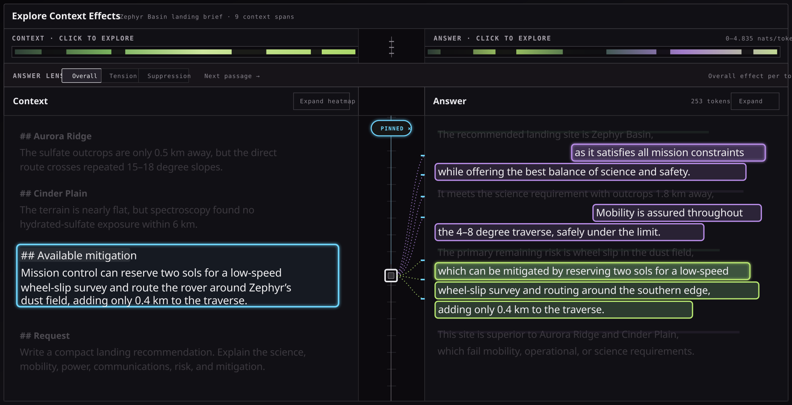

# Clozn

## Your context has consequences. You should see them.

Clozn shows which parts of a local LLM's context shaped the answer—and what you can remove without
changing it.

[](https://bkawa-io.github.io/clozn/)

### [Try the interactive recorded demo →](https://bkawa-io.github.io/clozn/)

No model download or inference required.

## How it works

At its core, Clozn is a local intervention and white-box runtime for GGUF models. Context attribution
is its first application: Clozn records an exact model execution, removes selected context, scores the
same answer again, and preserves the resulting evidence.

**Context Effects** connects influential context directly to the answer spans it affected.
**Lean Context** searches for a smaller prompt that preserves the answer. The optional **Stability
test** checks whether those effects change across different context combinations.

Clozn runs as a local, text-only OpenAI-compatible gateway, so an existing chat client can use it
normally while Studio records and investigates the conversation. Its context-attribution approach
builds on the research direction established by [ContextCite](https://github.com/MadryLab/context-cite),
using direct teacher-forced removal scoring rather than a surrogate estimator.

## Install locally

Requirements: Python 3.11+, Git, CMake, Ninja, and a C++ compiler on macOS or Linux.

```sh
# macOS
brew install python cmake ninja

# Ubuntu/Debian
sudo apt install python3 python3-venv build-essential cmake ninja-build git
```

Clone and install:

```sh
git clone https://github.com/bkawa-io/clozn.git
cd clozn
python3 scripts/install_local.py
```

Download the recommended model and start Clozn:

```sh
.venv-clozn/bin/clozn pull qwen3.5
.venv-clozn/bin/clozn serve qwen3.5 --port 8080
```

Open Studio at [http://127.0.0.1:8080/app/](http://127.0.0.1:8080/app/), or point an
OpenAI-compatible client at `http://127.0.0.1:8080/v1`.

`qwen3.5` is a multi-gigabyte download. Replace it with `qwen-0.5b` for a smaller first run.

```sh
.venv-clozn/bin/clozn doctor
```

I made this as one person in my free time for fun, sorry if it is buggy or bad.

Created by Brigitte Kawaguchi
