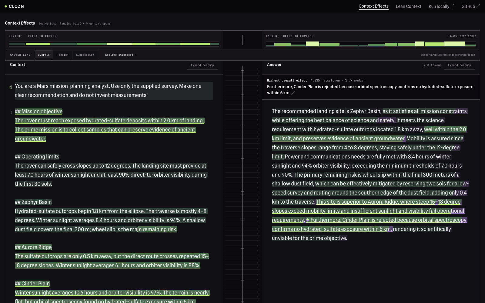

# CLOZN (WIP)

> Context attribution for everyday local inference.

[Try the recorded demo](https://bkawa-io.github.io/clozn/) ·
[Install from source](#install-from-source) ·
[Capability boundary](docs/CAPABILITIES.md)


Wondering how your context is influencing your model's response? Is the model ignoring
something you said? Want evidence fast without building a notebook or instrumenting your chat app?

**CLOZN can help.**

Clozn builds on the context-attribution research direction established by
[ContextCite](https://github.com/MadryLab/context-cite), bringing research-inspired measurements into
an everyday chat loop. Clozn v1 uses its own direct, teacher-forced removal scoring rather than being
a port of ContextCite's estimator.



*Context Effects: color and intensity encode support or suppression across the original context and
answer; selecting either side reveals its strongest relationships.*

Analysis requires additional model passes and can take minutes on local hardware. Chat generation
itself remains a normal OpenAI-compatible request.

## What v1 includes

The first release is deliberately narrow:

- a text-only OpenAI Chat Completions API for one local GGUF model;
- automatic Markdown-aware chunking across every input message;
- Context Effects linking context spans to answer spans, with Fast auto-routing and Exact scalar scoring;
- linked, heatmap, influence-ranking, and bounded Lean Context views;
- a Lean Context redline, kept-only context, and fresh before/after generations; and
- durable local conversations and basic deletion.

Research workbenches, J-lens/SAE views, steering, snapshots, model comparison suites, tools/structured
output, Responses, and Ollama-compatible APIs are not part of v1. See the
[current capability boundary](docs/CAPABILITIES.md).

## Recorded demo

The [recorded demo](https://bkawa-io.github.io/clozn/) is the quickest way to explore the reader and
its interactions. It uses bundled evidence, so it does not download a model or run new inference.

## Install from source

Requirements: Python 3.11 or newer, Git, CMake, Ninja, and a C++ compiler on macOS or Linux.

```sh
# macOS
brew install python cmake ninja

# Ubuntu/Debian
sudo apt install python3 python3-venv build-essential cmake ninja-build git
```

Clone the repository, then run the source installer:

```sh
git clone https://github.com/bkawa-io/clozn.git
cd clozn
python3 scripts/install_local.py
```

The installer fetches the pinned llama.cpp revision, builds the private worker (with Metal on Apple
silicon), and installs Clozn into `.venv-clozn`. Download the recommended model and start the gateway:

```sh
.venv-clozn/bin/clozn pull qwen3.5
.venv-clozn/bin/clozn serve qwen3.5 --port 8080
```

Open `http://127.0.0.1:8080/app/` for Studio, or point an OpenAI-compatible client at
`http://127.0.0.1:8080/v1`. `qwen3.5` is a multi-gigabyte download; use `qwen-0.5b` for a smaller
installation smoke test. The first native build takes several minutes; later starts reuse it.

Check the installation at any time with:

```sh
.venv-clozn/bin/clozn doctor
```

The same runtime can serve a command-line request:

```sh
.venv-clozn/bin/clozn run /absolute/path/to/model.gguf "Explain entropy."
```

The public CLI is exactly:

```text
run  serve  models  pull  studio  ps  stop  version  doctor
```

`clozn serve` also accepts the documented single-model aliases `-m`, `-c`, `-ngl`, `--host`, `-a`,
and `-np 1`; see [llama-server-style flags](docs/LLAMA_SERVER_COMPATIBILITY.md).

## Text API

Point an OpenAI-compatible client at `http://127.0.0.1:8080/v1`, or call the endpoint directly:

```sh
curl http://127.0.0.1:8080/v1/chat/completions \
  -H 'Content-Type: application/json' \
  -d '{
    "model": "clozn-local",
    "messages": [{"role": "user", "content": "Explain entropy."}],
    "stream": false
  }'
```

The supported public model endpoints are `GET /v1/models` and `POST /v1/chat/completions`.
Unsupported behavior-bearing fields receive a typed HTTP 400 instead of being ignored. Exact request
fields and response extensions are documented in [OpenAI compatibility](docs/OPENAI_COMPATIBILITY.md).

For example, the official OpenAI Python client only needs a different base URL:

```python
from openai import OpenAI

client = OpenAI(base_url="http://127.0.0.1:8080/v1", api_key="local")
model = client.models.list().data[0].id
reply = client.chat.completions.create(
    model=model,
    messages=[{"role": "user", "content": "Help me outline an essay."}],
)
print(reply.choices[0].message.content)
```

Clients keep the conversation by sending prior messages on each request, just as they do with OpenAI.
Clozn groups those recorded turns into one conversation automatically. Tools, multimodal input,
structured output, and the Responses API are intentionally outside v1.

Completed generation must be durably recorded before Clozn returns success. Non-streaming responses
include `clozn_run_id` and `X-Clozn-Run-Id`; the terminal streaming chunk includes `clozn_run_id`.

## Studio journey

Studio is a conversation reader with one analysis workspace:

1. open a recorded conversation and choose a request or response;
2. inspect the original context and answer in Context Effects;
3. select either side to reveal its strongest supporting and suppressing links;
4. switch between Overall, Tension, and Suppression lenses or expand either heatmap; and
5. open Lean Context to review the redline, kept-only context, and before/after generations.

Every non-empty input message is eligible for automatic chunking, including system instructions and the
latest user message. Context Effects and Lean Context use the same canonical source identities.
Context Effects is a teacher-forced intervention measurement. Lean Context uses bounded search to find
a smaller context within fixed probability-loss tolerances, then generates a fresh answer from both the
original and reduced contexts for comparison. Low measured effect, unmeasured, unavailable, failed, and
completed are distinct states. Clozn derives a flat Markdown-aware context partition automatically;
`CLOZN_MAX_CONTEXT_ARMS` sets the adaptive partition target (default 16), while
`CLOZN_MAX_CONTEXT_UNITS` sets the exact-unit safety ceiling (default 64). Lean Context keeps a separate
16-new-execution search budget, so long conversations do not spend more model work merely because they
contain more exact message units.

Studio defaults Context Effects to **Fast**, which uses recorded token counts to choose between packed
native prefix-trie scoring for prompt-heavy, short-answer work and exact scalar prefix-cached scoring
when answer decoding would dominate. Native batches are capacity-aware, include the unchanged control,
and may contain up to 16 sequences, with a conservative per-dispatch work ceiling so foreground chat can
run between large batches. **Exact** always uses the scalar reference scorer one condition at a time. The
two requested modes have separate experiment and observation identities; every result records the
strategy actually used, its evidence grade, per-phase timing, and the Fast routing reason.

## Data and privacy

v1 stores its SQLite journal, immutable trace blobs, evidence, and results under
`~/.clozn/v1/` by default. Set `CLOZN_DATA_ROOT` to choose an isolated location. Historical data under
`~/.clozn/runs/` is not imported or modified.

Run deletion is transactional. Unreferenced content-addressed blobs are cleaned through the same
mutation path.

## Qualification

With a gateway already running, exercise the retained live journey with:

```sh
python3 scripts/smoke/v1_acceptance.py \
  --base-url http://127.0.0.1:8080
```

The live harness is the model-backed qualification gate. The recorded demo and a fresh browser journey
remain separate release checks.

Model-free validation:

```sh
.venv/bin/python -m pytest -q tests clozn
cd studio-frontend && pnpm check && pnpm build
ctest --test-dir engine/core/build --output-on-failure
```

## Repository layout

| Path | Responsibility |
|---|---|
| `clozn/` | stdlib-only CLI, public gateway, run/evidence storage, and v1 analyses |
| `engine/client/` | private gateway-to-worker client |
| `engine/core/` | private GGUF worker: generation, template rendering, scoring, exact matching, cancellation |
| `studio-frontend/` | Studio source |
| `studio/` | built Studio assets served by the gateway |
| `protocol/` | private worker/gateway handshake and fixtures |
| `scripts/smoke/` | development and live acceptance harnesses |
| `docs/` | current architecture, contracts, development, and release guides |

The Python package has no runtime dependencies. The native worker owns model loading and inference; the
public gateway owns compatibility, recording, orchestration, and Studio.
